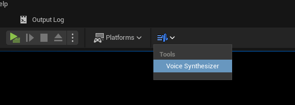
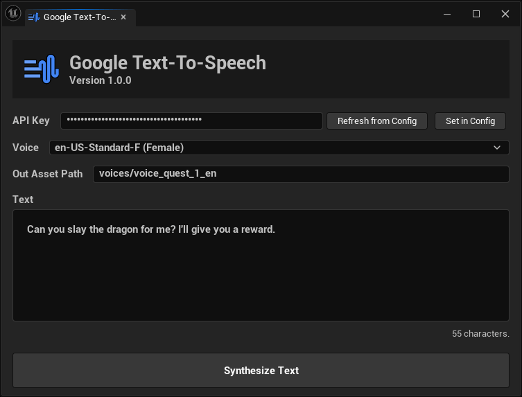

# Editor Tools
<a href="https://www.fab.com/listings/1ed738da-6aac-46c2-bbee-d2b42c68c3a9"
   target="_blank"
   rel="noopener noreferrer"
   onclick="gtag('event', 'download_plugin_click', {'event_category': 'outbound', 'event_label': 'Fab Marketplace Download'});"
   style="display:inline-block; padding:10px 18px; background:#0070f3; color:#ffffff; border:1px solid #0070f3; border-radius:6px; font-weight:600; font-family:sans-serif; font-size:15px; text-decoration:none;">
  Download the plugin
</a>

The plugin adds a **Voice Synthesizer** panel directly inside the Unreal Editor, so you can generate speech assets without leaving the engine. Open it from the editor's toolbar to get started.

1. If you didn't set your API key yet, enter the API key in the `API Key` field.
2. Select the voice for your language.
3. Enter the text you want to synthesize.
4. Add a valid path to where the asset should be created.
5. Click on `Synthesize Text`.

